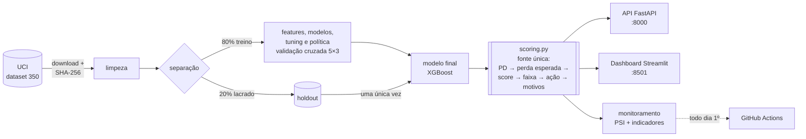
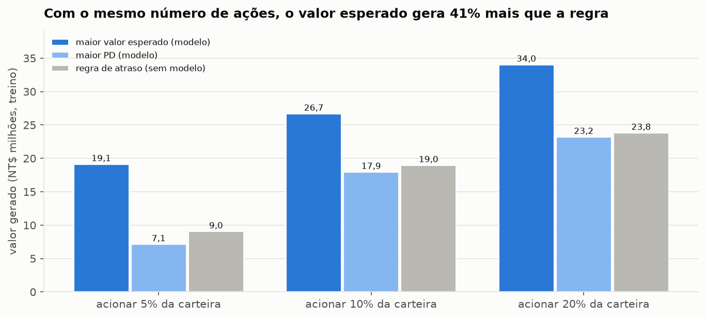
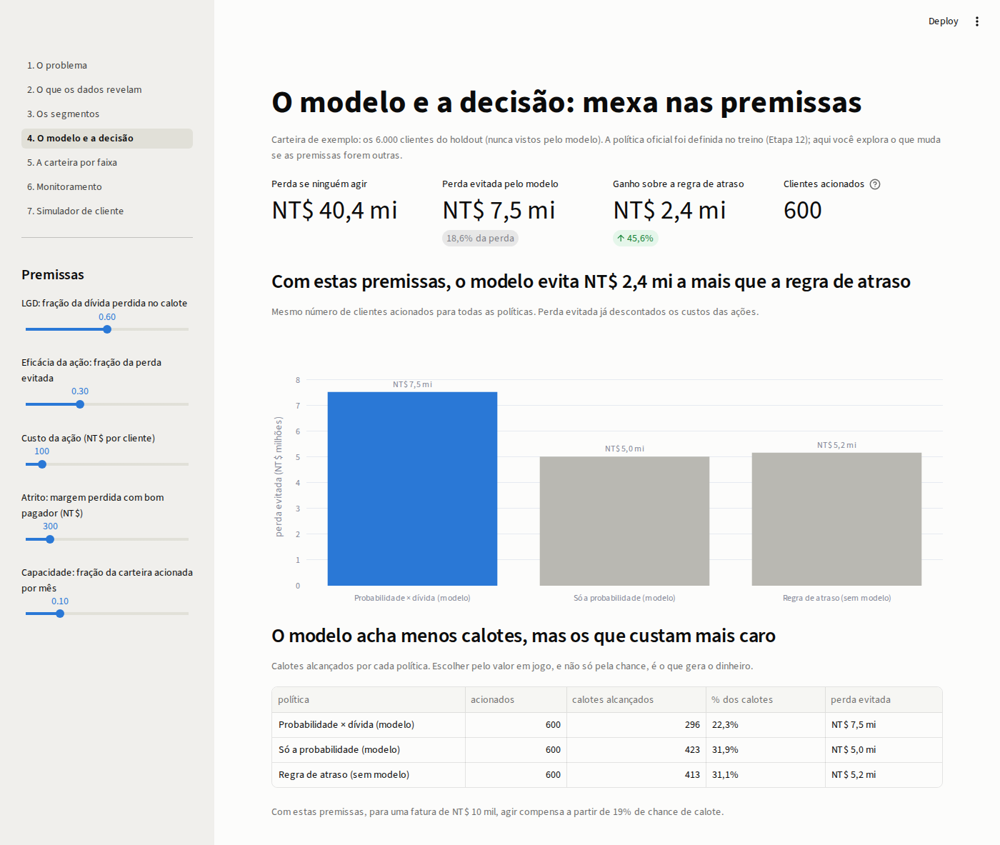
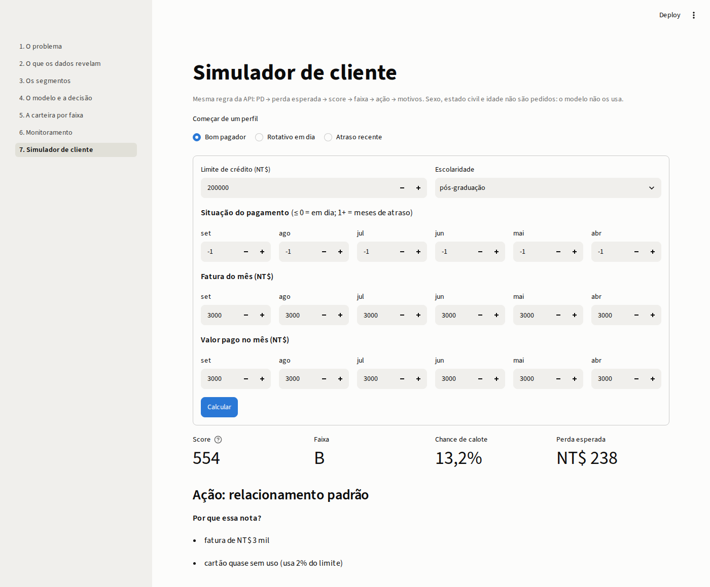

# Risco de Crédito Orientado a Custo

[](https://github.com/RToyoyama/credit-risk-semantix/actions/workflows/ci.yml)

[](LICENSE)

[](https://credit-risk-semantix-vsjmawoelrtyrwzz49nnaa.streamlit.app/)

> Projeto de parceria **EBAC × Semantix**.
>
> 🔗 **[Dashboard online](https://credit-risk-semantix-vsjmawoelrtyrwzz49nnaa.streamlit.app/)** · 📄 **[Relatório](docs/RELATORIO.md)** (Coleta de dados · Modelagem · Conclusões) · 🧾 **[Model card](docs/model_card.md)** · 📖 **[Glossário](docs/GLOSSARIO.md)**

**Em uma frase:** um sistema que ajuda uma emissora de cartão de crédito a decidir, todo mês, **em quais clientes agir antes que eles deixem de pagar**, escolhendo pelo **dinheiro em jogo**, e não pela taxa de acerto.

---

## Resumo executivo

**O problema.** 22% dos clientes de cartão desta base deixam de pagar a fatura seguinte. Agir antes (contato, renegociação, revisão de limite) reduz a perda, mas custa dinheiro e incomoda bons clientes, e a equipe só consegue atender **10% da carteira por mês**. A pergunta é: **quais 10%?**

**O resultado.** Testado uma única vez em **6.000 clientes que o modelo nunca viu**:

| Quem acionar (600 clientes) | Valor líquido (perda evitada − custos) |
|---|---|
| Ninguém | NT$ 0 (a perda de NT$ 40,4 mi segue inteira) |
| Regra de atraso (os mais atrasados primeiro, sem modelo) | NT$ 5,17 mi |
| **Os de maior valor esperado (modelo)** | **NT$ 7,52 mi** |

**+NT$ 2,36 milhões (+46%) a mais que a regra de atraso** (intervalo de confiança de 95%: +1,59 a +3,15 mi), evitando 18,6% da perda da carteira. No treino, o modelo vence a regra em **12 de 12** cenários de premissas de negócio testados.

**A recomendação.** Adotar a política "acionar os 10% de maior valor esperado", com score 0–1000, faixas A–E e os motivos de cada decisão, monitorada mensalmente. Começar com um **piloto com grupo de controle** para medir a eficácia real da ação, a premissa que mais pesa no valor.

**O achado que muda a decisão:** um bom modelo de risco **sozinho não basta**. Escolher só pela probabilidade de calote **empata com a regra de atraso**. O ganho aparece quando se combina a probabilidade com **quanto o cliente deve**.

---

## 1. O problema

Um cartão de crédito é um empréstimo de curto prazo: o cliente compra hoje e paga no mês seguinte. A maioria paga; uma parte, não. Isso é a **inadimplência**, que o mercado chama de **default**. Quando o calote acontece, o banco recupera só uma parte da dívida, e tarde. Por isso vale mais **agir antes**, só que agir também custa.

### Os dois erros não custam igual

| O modelo erra assim | O que acontece | Quanto custa |
|---|---|---|
| Diz "vai pagar", mas o cliente dá calote | ninguém age e o prejuízo passa | **caro**: a parte da dívida que não volta |
| Diz "vai dar calote", mas o cliente pagaria | age-se à toa num bom cliente | **barato, mas não zero**: custo da ação + incômodo |

**Exemplo:** um cliente deve NT$ 10.000. Se ele der calote, o banco perde 60% disso (NT$ 6.000). Com as premissas do projeto, agir nele compensa a partir de **19%** de chance de calote, e não de 50%. Se ele devesse só NT$ 2.000, o corte subiria para **62%**. O ponto de corte depende do valor em jogo de cada cliente.

### Por que "acurácia" engana aqui

Um "modelo" que diz "ninguém vai dar calote" acerta **77,88%** das vezes, sem ajudar em nada. Os quatro modelos testados ficam entre 81,8% e 82,2% de acurácia, e o de maior acurácia não é o melhor. Por isso o projeto mede o sucesso em **dinheiro**.

---

## 2. O que o projeto entrega

Uma **política de crédito para a carteira**, em camadas, do risco de cada cliente até a decisão do gestor:

| Pergunta de negócio | O que o projeto produz | Onde |
|---|---|---|
| Quem tem risco? | **probabilidade de calote** (*PD*) de cada cliente | [`final.py`](src/credit_risk/final.py) |
| Quanto isso custa? | **perda esperada** em dinheiro: chance × quanto deve × quanto se perderia | [`expected_loss.py`](src/credit_risk/expected_loss.py) |
| O que fazer com cada cliente? | **score de 0 a 1000** e **faixas A–E**, cada uma com uma ação | [`scoring.py`](src/credit_risk/scoring.py) |
| Por que essa decisão? | os **3 principais motivos** em frases ("2 meses de atraso no último pagamento") | [`reasons.py`](src/credit_risk/reasons.py) |
| Quando o modelo "envelhece"? | **monitoramento** mensal com alarme | [`monitoring.py`](src/credit_risk/monitoring.py) |
| Como usar no dia a dia? | **API** que devolve score, faixa e motivos | [`api/`](api/) |
| Como o gestor decide? | **dashboard** com simuladores de custo, faixas e carteira | [`app/`](app/) |

---

## 3. Arquitetura



API, dashboard e avaliação passam pelo mesmo `scoring.py`: uma regra de negócio existe em **um só lugar**. O [relatório](docs/RELATORIO.md#320-arquitetura-e-como-seria-em-produção) mostra como a rotina mensal viraria uma DAG no Airflow numa operação maior.

---

## 4. Os dados

*Default of Credit Card Clients* (Yeh & Lien, 2009), do [UCI Machine Learning Repository](https://archive.ics.uci.edu/dataset/350/default+of+credit+card+clients), licença CC BY 4.0. Dados públicos e anonimizados, baixados direto da fonte (sem login).

| | |
|---|---|
| Clientes | 30.000 de um banco de Taiwan |
| Período | abril a setembro de 2005 |
| Informações | limite de crédito, perfil (sexo, idade, escolaridade, estado civil) e 6 meses de histórico: situação do pagamento, valor da fatura e valor pago |
| Alvo | o cliente deu calote em outubro de 2005? (sim/não) |
| Inadimplentes | 6.636 (22,12%) |

Ficha completa: [`docs/data_card.md`](docs/data_card.md).

---

## 5. Resultados, em ordem

| # | Achado | O que muda para o negócio |
|---|---|---|
| 1 | **O atraso recente é o sinal mais forte.** Com 2 meses de atraso em setembro, **69%** deram calote em outubro (13% de quem pagou o mínimo) | o histórico de pagamento é a base do modelo |
| 2 | **Uma suposição comum sobre estes dados estava errada:** o código -2 quer dizer "quitou a fatura", não "sem consumo" | a análise verificou a documentação em vez de aceitá-la |
| 3 | **Três tipos de cliente** (PCA + K-means, sem usar o alvo): quitadores (16,7% de calote), rotativo em dia (18,8%) e atraso crônico (**62,4%**) | o risco vem do **atraso**, não do uso do rotativo |
| 4 | **XGBoost × Árvore de Decisão × Random Forest × logística:** o XGBoost ajustado lidera (PR AUC 0,566, contra 0,22 sem modelo) | modelo de referência |
| 5 | **Balancear classes, combinar modelos e calibrar não ajudaram** (critérios fixados antes) | sistema mais simples: XGBoost sozinho |
| 6 | **O modelo não precisa de sexo, estado civil nem idade:** sem eles, desempenho e valor ficam iguais | fora do modelo; servem só para auditar |
| 7 | **Em dinheiro, o modelo vence a regra de atraso:** +NT$ 7,7 mi no treino (+41%) e **+NT$ 2,36 mi no holdout (+46%)** | política oficial: 10% de maior valor esperado |
| 8 | **A validação cruzada previu a prova final:** PR AUC 0,566 → 0,560 | o resultado não depende de sorte |
| 9 | **A perda esperada acerta o tamanho da perda:** NT$ 39,4 mi previstos × NT$ 40,4 mi reais (−2,3%) | base para provisionar |
| 10 | **Faixas A–E monotônicas:** calote de **6% (A)** → 14% → 20% → 38% → **71% (E)**, igual no treino e no holdout | cada faixa tem uma ação; a E concentra cerca de 40% da perda |
| 11 | **Motivos em português por cliente:** "2 meses de atraso no último pagamento · atraso em 1 dos últimos 6 meses · usa 98% do limite" | o cliente e o analista entendem o porquê |
| 12 | **Sem viés por sexo ou idade:** a PD erra no máximo 2,0 p.p. em qualquer grupo | auditoria de equidade aprovada |
| 13 | **O índice padrão de estabilidade (PSI) não percebeu uma crise simulada**; PD média e participação da faixa E perceberam | monitoramento com PSI + indicadores de negócio |



Detalhes e todos os números: [relatório](docs/RELATORIO.md) e notebooks de [EDA](notebooks/01_eda_inferencia.ipynb), [segmentação](notebooks/02_segmentacao.ipynb) e [modelagem e decisão](notebooks/03_modelagem_e_decisao.ipynb).

---

## Dashboard

> 🔗 **[Versão online](https://credit-risk-semantix-vsjmawoelrtyrwzz49nnaa.streamlit.app/)** (na primeira visita do dia, o app pode levar até 1 minuto para acordar e preparar os dados)

Sete páginas, do problema à decisão, com controles para testar outras premissas de negócio e um simulador de cliente. Localmente: `make app`.

| Mexa nas premissas e veja o valor do modelo | Simulador: score, faixa e motivos |
|---|---|
|  |  |

---

## 6. Como o projeto garante resultados confiáveis

| Cuidado | Por quê |
|---|---|
| **Prova final lacrada:** 20% dos clientes (6.000) separados no início e usados **uma única vez** (`make final` se recusa a reavaliar) | evita escolher o modelo "olhando a prova"; os IDs estão em [`reports/holdout_ids.csv`](reports/holdout_ids.csv) |
| **Critérios definidos antes de cada experimento** | evita ajustar a régua depois de ver o resultado; as 3 decisões tomadas depois estão registradas no relatório |
| **Dados verificados na entrada:** conferência da "impressão digital" do arquivo (SHA-256) e validação de colunas, tipos e faixas | se a fonte mudar, o processo para |
| **Uma única fonte de verdade para as regras de negócio** | API, dashboard e avaliação usam o mesmo `scoring.py` |
| **Reprodução verificada:** `make docker-reproduce` reconstrói tudo do zero e compara as métricas do holdout | diferença obtida: **0,0** |
| **215 testes automatizados** e verificação de código a cada push (GitHub Actions) | o selo "CI" no topo mostra o estado atual |

**Decisões conscientes de simplicidade:** a base tem 30 mil linhas e cabe na memória de qualquer computador, então o projeto usa pandas e scikit-learn, e não Spark ou dbt. Também não há Airflow: o monitoramento é uma função (`run_monitoring`) que qualquer agendador pode chamar; aqui, um job mensal no GitHub Actions ([`monitor.yml`](.github/workflows/monitor.yml)).

---

## 7. Como rodar

### Com Docker (mais simples)

```bash
git clone https://github.com/RToyoyama/credit-risk-semantix.git
cd credit-risk-semantix
make up        # ou: docker compose up -d
```

Na primeira vez, a API baixa os dados da UCI e treina o modelo (cerca de 1 minuto). Depois: API em http://localhost:8000/docs e dashboard em http://localhost:8501. `make down` desliga tudo.

### Local

Pré-requisitos: Linux, macOS ou WSL, com [`uv`](https://docs.astral.sh/uv/) e `make`.

```bash
git clone https://github.com/RToyoyama/credit-risk-semantix.git
cd credit-risk-semantix

make venv         # cria o ambiente com Python 3.11
make install      # instala as versões exatas do requirements.lock
make data         # baixa os dados da UCI, confere o SHA-256 e valida
make split        # limpa os dados e separa treino / holdout
make experiments  # roda os experimentos e salva os resultados em reports/
make tune         # ajuste de hiperparâmetros (~10 min)
make final        # treina o modelo final e avalia a prova lacrada (só roda uma vez)
make monitor      # estabilidade do score e das variáveis em lotes de clientes
make api          # API em http://localhost:8000 (documentação em /docs)
make app          # dashboard em http://localhost:8501
make test         # testes
```

`make help` lista todos os comandos. Os notebooks usam o Python do `.venv` como kernel e leem os resultados salvos em `reports/` (para refazer os experimentos, `RERUN_EXPERIMENTS = True` no início do notebook 03).

### Exemplo: chamando a API

Um cliente com 2 meses de atraso e fatura de NT$ 48,5 mil:

```bash
curl -X POST http://localhost:8000/score -H "Content-Type: application/json" -d '{
  "id": 101, "limit_bal": 50000, "education": 2,
  "pay_status_1": 2, "pay_status_2": 2, "pay_status_3": 0, "pay_status_4": 0, "pay_status_5": 0, "pay_status_6": 0,
  "bill_amt_1": 48500, "bill_amt_2": 47000, "bill_amt_3": 46200, "bill_amt_4": 30000, "bill_amt_5": 28000, "bill_amt_6": 25000,
  "pay_amt_1": 0, "pay_amt_2": 1500, "pay_amt_3": 2000, "pay_amt_4": 1500, "pay_amt_5": 1000, "pay_amt_6": 1000
}'
```

Resposta (resumida):

```json
{
  "pd": 0.611, "score": 352, "faixa": "E",
  "acao": "candidato prioritário a ação preventiva", "prioritario": true,
  "perda_esperada": 17783.42,
  "motivos": [
    "2 meses de atraso no último pagamento",
    "atraso em 2 dos últimos 6 meses (pior atraso: 2 meses)",
    "comportamento de pagamento: pagou 0% da fatura anterior"
  ],
  "versao_modelo": "0.1.0", "versao_api": "1.0"
}
```

A API **não aceita** sexo, estado civil nem idade (o modelo não usa esses dados; enviar um deles retorna erro 422).

---

## 8. Estrutura do repositório

```
credit-risk-semantix/
├── .github/workflows/     # CI (lint + testes + Docker) e monitoramento mensal
├── api/                   # API de scoring (FastAPI): contratos e endpoints
├── app/                   # dashboard (Streamlit): 7 páginas
├── data/                  # raw → interim → processed (gerados por make, fora do Git)
├── docs/
│   ├── RELATORIO.md       # Coleta de dados | Modelagem | Conclusões
│   ├── model_card.md      # ficha do modelo: uso, métricas, equidade, riscos
│   ├── data_card.md       # ficha dos dados
│   ├── GLOSSARIO.md       # termos técnicos explicados de forma simples
│   └── images/            # capturas do dashboard
├── notebooks/
│   ├── 01_eda_inferencia.ipynb
│   ├── 02_segmentacao.ipynb
│   └── 03_modelagem_e_decisao.ipynb
├── reports/
│   ├── figures/           # gráficos gerados
│   ├── *.csv / *.json     # resultado de cada experimento
│   └── holdout_ids.csv    # IDs da prova final lacrada
├── src/credit_risk/
│   ├── config.py          # caminhos, seeds, premissas de negócio e critérios
│   ├── data.py            # download verificado e validação
│   ├── cleaning.py        # limpeza com regras fixas
│   ├── split.py           # separação do holdout
│   ├── stats.py           # intervalos de confiança, testes e tamanhos de efeito
│   ├── features.py        # variáveis de comportamento e de resumo
│   ├── segmentation.py    # PCA + K-means e perfil dos segmentos
│   ├── preprocessing.py   # escala e one-hot dentro do pipeline
│   ├── models.py          # catálogo de modelos e pipeline final
│   ├── evaluate.py        # validação cruzada, KS, calibração e comparação pareada
│   ├── balancing.py       # nenhum × pesos por classe × SMOTE
│   ├── tuning.py          # busca de hiperparâmetros com semente separada
│   ├── decision.py        # calibração e política de decisão por custo
│   ├── explain.py         # VIF e razões de chances
│   ├── final.py           # treino final e avaliação única no holdout
│   ├── expected_loss.py   # perda esperada por cliente e carteira
│   ├── scoring.py         # fonte única: PD → perda esperada → score → faixa → ação → motivos
│   ├── reasons.py         # motivos da decisão por cliente (TreeSHAP)
│   ├── monitoring.py      # PSI e indicadores de estabilidade por lote
│   ├── artifacts.py       # reconstrói dados, modelo e previsões que faltarem
│   ├── reproduce.py       # confere se as métricas do holdout se reproduzem
│   ├── experiments.py     # experimentos pareados (resultados em reports/)
│   └── viz.py             # estilo padrão dos gráficos
├── tests/                 # testes automatizados
├── Dockerfile             # imagem única para API e dashboard
├── docker-compose.yml     # sobe API (8000) e dashboard (8501)
├── Makefile
├── pyproject.toml
└── requirements.lock      # versões exatas de todas as dependências
```

---

## 9. Lições aprendidas

- **Uma prova lacrada de verdade dá confiança.** No meu projeto anterior (Titanic), a validação dizia 0,85 e a realidade foi 0,78. Aqui, com o holdout separado no primeiro dia, a validação previu a prova final com diferença de 0,006.
- **O objetivo é dinheiro, não métrica.** O modelo com a melhor probabilidade de calote empatou com uma regra simples até entrar o valor em jogo de cada cliente.
- **Fixar o critério antes evita se enganar.** Balanceamento, ensemble, calibração e segmentos como variável foram rejeitados por regra, e o sistema ficou mais simples.
- **Desconfiar da documentação dos dados.** O código -2 não significava o que se costuma supor.
- **A métrica padrão do mercado pode falhar.** O PSI não viu uma crise simulada; indicadores de negócio viram.
- **Olhar o produto pega erros que os testes não pegam.** As capturas do dashboard revelaram um cálculo errado; o deploy na nuvem revelou um erro de caminho que não aparecia localmente.

---

## 10. Limitações

- Os dados são de **2005**, de **um único banco de Taiwan**. O método se transfere; o modelo treinado, não.
- Não há renda, dívida total nem dados de birô de crédito, que um modelo real usaria.
- Só há 6 meses de histórico e um único mês de desfecho, num período próximo à crise de cartões de Taiwan (2005–2006).
- As premissas de negócio (perda de 60% no calote, eficácia da ação de 30%, custos) são referências, não medições. A conclusão resiste a elas (12 de 12 cenários), mas o valor em dinheiro depende delas.

Lista completa e próximos passos: [Conclusões do relatório](docs/RELATORIO.md#4-conclusões).

---

## Autorização de uso (LGPD)

Eu, **[NOME COMPLETO]**, portador(a) do RG **[RG]** e inscrito(a) no CPF **[CPF]**, autorizo a Semantix a utilizar este trabalho, desenvolvido no projeto de parceria EBAC × Semantix, para fins de avaliação no processo seletivo e de divulgação, nos termos da Lei nº 13.709/2018 (LGPD).

> Os campos entre colchetes são **marcadores** e não devem ser preenchidos neste repositório público. Os dados pessoais são informados apenas no formulário de entrega da plataforma.

---

**Autor:** Renan Toyoyama · [GitHub](https://github.com/RToyoyama) · Código sob [licença MIT](LICENSE); dados sob CC BY 4.0 (UCI).

**Citação dos dados:** Yeh, I. C., & Lien, C. H. (2009). The comparisons of data mining techniques for the predictive accuracy of probability of default of credit card clients. *Expert Systems with Applications, 36*(2), 2473–2480.
