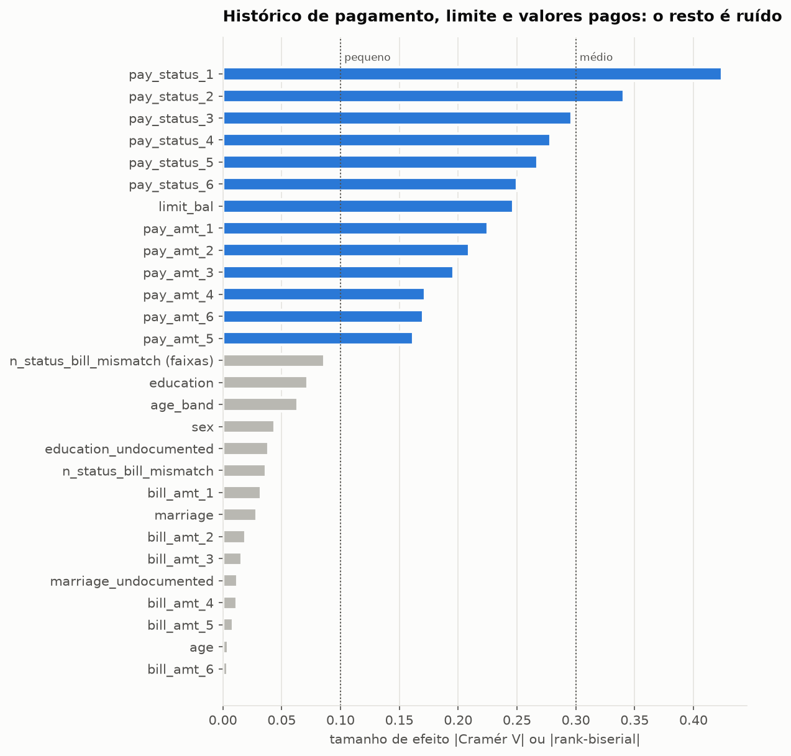

# Risco de Crédito Orientado a Custo


[](LICENSE)


> Projeto de parceria **EBAC × Semantix**. Em construção: esta página mostra o que já está pronto e o que vem a seguir.

**Em uma frase:** um sistema que ajuda uma emissora de cartão de crédito a decidir, todo mês, **em quais clientes agir antes que eles deixem de pagar**, escolhendo a decisão pelo **dinheiro em jogo**, e não pela taxa de acerto.

---

## 1. O problema

Um cartão de crédito é um empréstimo de curto prazo: o cliente compra hoje e paga no mês seguinte. A maioria paga, mas uma parte não paga. Isso é a **inadimplência**, que o mercado chama de **default**. Quando o calote acontece, o banco recupera só uma parte da dívida, e tarde.

Por isso vale mais **agir antes**: oferecer renegociação, reduzir o limite ou fazer um contato preventivo. Só que agir também custa, e é aí que a decisão fica difícil.

### Os dois erros não custam igual

| O modelo erra assim | O que acontece | Quanto custa |
|---|---|---|
| Diz "vai pagar", mas o cliente dá calote | ninguém age e o prejuízo passa | **caro**: a parte da dívida que não volta |
| Diz "vai dar calote", mas o cliente pagaria | age-se à toa num bom cliente | **barato, mas não zero**: custo da ação + incômodo |

**Exemplo ilustrativo** (valores hipotéticos, só para mostrar a ideia): um cliente deve NT$ 10.000. Se ele der calote, o banco perde 60% disso, NT$ 6.000. Uma ação preventiva custa NT$ 200. Então deixar passar **um** caloteiro custa o mesmo que incomodar **30** bons clientes. A regra "agir quando a chance de calote passar de 50%" ignora essa diferença; a regra certa é a que **minimiza o custo total**.

### Por que "acurácia" engana aqui

Nesta base, **22,12%** dos clientes deram calote. Um "modelo" que diz "ninguém vai dar calote" acerta **77,88%** das vezes, sem ajudar em nada. Por isso este projeto mede o sucesso em **dinheiro**.

---

## 2. O que o projeto entrega

A entrega não é um número de acurácia. É uma **política de crédito para a carteira**, construída em camadas, do risco de cada cliente até a decisão do gestor:

| Pergunta de negócio | O que o projeto produz | Status |
|---|---|---|
| Quem tem risco? | **probabilidade de calote** de cada cliente (*PD*), calibrada para ser uma chance real | ⏳ Etapas 9–13 |
| Quanto isso custa? | **perda esperada** em dinheiro por cliente: chance × quanto deve × quanto se perderia | ⏳ Etapa 14 |
| O que fazer com cada cliente? | **score de 0 a 1000** e **faixas de risco A–E**, cada uma com uma ação | ⏳ Etapa 14 |
| Por que essa decisão? | os **3 principais motivos** de cada cliente, em frases ("2 meses de atraso no último pagamento") | ⏳ Etapa 15 |
| Quando o modelo "envelhece"? | **monitoramento**: alarme quando os clientes novos ficam diferentes dos de treino | ⏳ Etapa 16 |
| Como usar no dia a dia? | **API** que recebe os dados de um cliente e devolve score, faixa e motivos | ⏳ Etapa 17 |
| Como o gestor decide? | **dashboard** com simuladores de custo, faixas e carteira | ⏳ Etapa 18 |

**Como saberemos se funcionou** (critério fixado **antes** de ver os resultados): o modelo só será recomendado se der **mais resultado financeiro** do que (1) não agir em ninguém **e** (2) a melhor regra simples de atraso, como "agir em quem atrasou 2 meses". Se ele não vencer a regra simples, isso será documentado.

---

## 3. Os dados

*Default of Credit Card Clients* (Yeh & Lien, 2009), do [UCI Machine Learning Repository](https://archive.ics.uci.edu/dataset/350/default+of+credit+card+clients), licença CC BY 4.0. São dados públicos e anonimizados.

| | |
|---|---|
| Clientes | 30.000 de um banco de Taiwan |
| Período | abril a setembro de 2005 |
| Informações | limite de crédito, perfil (sexo, idade, escolaridade, estado civil) e 6 meses de histórico: situação do pagamento, valor da fatura e valor pago |
| Alvo | o cliente deu calote em outubro de 2005? (sim/não) |
| Inadimplentes | 6.636 (22,12%) |

Ficha completa, com dicionário de variáveis e limitações: [`docs/data_card.md`](docs/data_card.md).

---

## 4. O que já descobrimos

A análise exploratória (Etapa 5) usou **só os dados de treino** e testou cada relação com estatística. Com 24 mil clientes, quase tudo sai "estatisticamente significativo", por isso cada teste vem com o **tamanho do efeito**, que diz se a diferença é grande o bastante para importar.



| Achado | O que significa para o negócio |
|---|---|
| **O atraso recente é o sinal mais forte.** Com 2 meses de atraso em setembro, **69%** deram calote em outubro (contra 13% de quem pagou o mínimo) | o histórico de pagamento é a base do modelo; o mês mais recente vale mais que os antigos |
| **Limite baixo, mais risco:** 32% de calote no quinto de clientes com menor limite e 13% no de maior | o limite entra no modelo, e também a utilização (fatura ÷ limite) |
| **Quanto o cliente paga importa; o tamanho da fatura, não** | uma fatura de NT$ 50 mil diz pouco sozinha; ela precisa ser comparada com o limite e com o pagamento |
| **Sexo, idade, escolaridade e estado civil mudam pouco o risco** | o perfil demográfico não deve guiar a política; usar ou não essas variáveis será decidido com uma checagem de equidade |
| **Uma suposição comum sobre estes dados estava errada:** o código -2 não quer dizer "sem consumo", e sim "quitou a fatura" | o documento dos dados foi corrigido; a análise verificou a suposição em vez de aceitá-la |
| **Três tipos de cliente** (Etapa 6, formados sem saber quem deu calote): **quitadores** (43%, 16,7% de calote), **rotativo em dia** (47%, 18,8%) e **atraso crônico** (10%, **62,4%**) | o risco vem do **atraso**, não do uso do rotativo: tratar o rotativo como risco cortaria receita sem reduzir perda |
| **Os grupos não ajudam o modelo a prever** (ganho nulo nos dois modelos testados) | resultado negativo documentado: os grupos servem para **explicar** a carteira, não para prever |
| **XGBoost e Random Forest empatam na frente** (Etapa 9): PR AUC 0,563 e 0,562, contra 0,22 de quem não sabe nada. A acurácia dos quatro modelos testados fica entre 81,8% e 82,2% e não serve para escolher | os dois seguem para o ajuste fino |
| **Depois do ajuste fino, o XGBoost lidera sozinho** (Etapa 11): PR AUC 0,566. O ajuste rendeu pouco nos modelos fortes (+0,003) | XGBoost ajustado é o modelo de referência |
| **Em dinheiro, o modelo vence a regra de atraso** (Etapa 12): acionando 10% da carteira por mês, escolher pelo valor esperado (chance de calote × dívida) gera **NT$ 26,6 milhões**, contra NT$ 19,0 milhões da regra "mais atrasados primeiro" (+40%; IC 95% da diferença: +6,3 a +9,1 mi). O modelo vence em todos os 12 cenários de premissas testados | política oficial: acionar os 10% de maior valor esperado |
| **Um bom modelo de risco sozinho não basta**: escolher só pela probabilidade de calote **perde** da regra de atraso. O ganho vem de combinar a probabilidade com o valor em jogo | base para a perda esperada e o score (Etapa 14) |
| **Combinar modelos não compensa**: os modelos erram nos mesmos clientes (correlação dos erros de até 0,998) e o melhor ensemble ganha +0,0009, menos que o ruído | modelo final: **XGBoost ajustado, sozinho** |
| **"Balancear" as classes atrapalha** (Etapa 10): não melhora a detecção e faz o modelo prever, em média, 41% de chance de calote quando a taxa real é 22% | as probabilidades ficam confiáveis, o que é essencial para calcular a perda em dinheiro |
| **Um mês de atraso recente dobra a chance de calote** (razão de chances 1,99); dobrar o limite reduz a chance em cerca de 16% | base para explicar cada decisão ao cliente |
| **Resumir o histórico ajuda** (Etapa 7): "meses com atraso" é a variável mais forte do projeto; com 13 variáveis de resumo, a regressão logística melhorou em todas as 15 rodadas de teste | as variáveis de resumo entram no modelo |

Detalhes: notebooks de [EDA](notebooks/01_eda_inferencia.ipynb) e de [segmentação](notebooks/02_segmentacao.ipynb), e o [relatório](docs/RELATORIO.md#3-modelagem).

---

## 5. Como o projeto garante resultados confiáveis

| Cuidado | Por quê |
|---|---|
| **Prova final lacrada:** 20% dos clientes (6.000) separados no início e usados **uma única vez**, no fim | evita escolher o modelo "olhando a prova"; os IDs ficam em [`reports/holdout_ids.csv`](reports/holdout_ids.csv) para qualquer pessoa conferir |
| **Critérios definidos antes dos experimentos** | evita ajustar a régua depois de ver o resultado |
| **Dados verificados na entrada:** download direto da fonte oficial, com conferência da "impressão digital" do arquivo (SHA-256) e validação de colunas, tipos e faixas | se a fonte mudar, o processo para em vez de seguir com dados diferentes |
| **Uma única fonte de verdade para as regras de negócio** | API, dashboard e avaliação usam o mesmo código de scoring (a partir da Etapa 14) |
| **Testes automatizados** e verificação de código a cada commit | hoje: 144 testes |

**Decisão consciente:** a base tem 30 mil linhas e cabe na memória de qualquer computador. Por isso o projeto usa pandas e scikit-learn, e não ferramentas de big data (Spark, dbt, Airflow), que só aumentariam a complexidade sem nenhum ganho.

---

## 6. Andamento

| Etapa | Entrega | |
|---|---|---|
| 1 | Problema de negócio e repositório | ✅ |
| 2 | Ambiente reprodutível (versões travadas, testes, verificação de código) | ✅ |
| 3 | Coleta dos dados com verificação | ✅ |
| 4 | Limpeza e separação da prova final (holdout) | ✅ |
| 5 | Análise exploratória com inferência estatística | ✅ |
| 6 | Segmentação de clientes (PCA + K-means) | ✅ |
| 7 | Criação de variáveis | ✅ |
| 8 | Pré-processamento | ✅ |
| 9 | Duelo de modelos (logística × árvore × Random Forest × XGBoost) | ✅ |
| 10 | Balanceamento de classes (resultado: não usar) | ✅ |
| 11 | Ajuste fino e combinação de modelos | ✅ |
| 12 | Calibração e política de decisão por custo | ✅ |
| 13 | Avaliação final na prova lacrada | ⏳ |
| 14–16 | Perda esperada, score e faixas, motivos, monitoramento | ⏳ |
| 17–19 | API, dashboard, Docker e integração contínua | ⏳ |
| 20–21 | Documentação final e entrega | ⏳ |

---

## 7. Como rodar

Pré-requisitos: Linux, macOS ou WSL, com [`uv`](https://docs.astral.sh/uv/) e `make`.

```bash
git clone https://github.com/RToyoyama/credit-risk-semantix.git
cd credit-risk-semantix

make venv      # cria o ambiente com Python 3.11
make install   # instala as versões exatas do requirements.lock
make data      # baixa os dados da UCI, confere o SHA-256 e valida
make split     # limpa os dados e separa treino / holdout
make experiments  # roda os experimentos e salva os resultados em reports/
make tune      # ajuste de hiperparâmetros (~10 min)
make test      # roda os testes
```

`make help` lista todos os comandos. O notebook da EDA fica em `notebooks/01_eda_inferencia.ipynb` (use o Python do `.venv` como kernel).

---

## 8. Estrutura do repositório

```
credit-risk-semantix/
├── data/                  # raw → interim → processed (gerados por make, fora do Git)
├── docs/
│   ├── RELATORIO.md       # Coleta de dados | Modelagem | Conclusões
│   ├── data_card.md       # ficha dos dados
│   └── GLOSSARIO.md       # termos técnicos explicados de forma simples
├── notebooks/
│   ├── 01_eda_inferencia.ipynb
│   ├── 02_segmentacao.ipynb
│   └── 03_modelagem_e_decisao.ipynb
├── reports/
│   ├── figures/           # gráficos gerados
│   ├── eda_tests.csv      # resultado de todos os testes estatísticos
│   ├── segment_*.csv      # escolha de k, perfis e experimento dos segmentos
│   ├── *_experiment.csv   # resultados dos experimentos pareados
│   └── holdout_ids.csv    # IDs da prova final lacrada
├── src/credit_risk/
│   ├── config.py          # caminhos, seeds, schema e critérios
│   ├── data.py            # download verificado e validação
│   ├── cleaning.py        # limpeza com regras fixas
│   ├── split.py           # separação do holdout
│   ├── stats.py           # intervalos de confiança, testes e tamanhos de efeito
│   ├── features.py        # features comportamentais e de resumo (regras fixas)
│   ├── segmentation.py    # PCA + K-means e perfil dos segmentos
│   ├── preprocessing.py   # escala e one-hot dentro do pipeline
│   ├── models.py          # catálogo de modelos e pipeline completo
│   ├── balancing.py       # nenhum × pesos por classe × SMOTE
│   ├── tuning.py          # busca de hiperparâmetros com semente separada
│   ├── decision.py        # calibração e política de decisão por custo
│   ├── evaluate.py        # validação cruzada, KS, calibração e comparação pareada
│   ├── explain.py         # VIF e razões de chances
│   ├── experiments.py     # experimentos pareados (resultados em reports/)
│   └── viz.py             # estilo padrão dos gráficos
├── tests/                 # testes automatizados
├── Makefile
├── pyproject.toml
└── requirements.lock      # versões exatas de todas as dependências
```

---

## 9. Documentação

- [**Relatório**](docs/RELATORIO.md): problema, coleta de dados, modelagem e conclusões
- [**Data card**](docs/data_card.md): fonte, licença, dicionário de variáveis e limitações
- [**Glossário**](docs/GLOSSARIO.md): todo termo técnico do projeto explicado em linguagem simples

---

## 10. Limitações

- Os dados são de **2005**, de **um único banco de Taiwan**. O método se transfere; o modelo treinado, não.
- Não há renda, dívida total nem dados de birô de crédito, que um modelo real usaria.
- Só há 6 meses de histórico e um único mês de desfecho, num período próximo à crise de cartões de Taiwan (2005–2006).

---

**Autor:** Renan Toyoyama · [GitHub](https://github.com/RToyoyama) · Código sob [licença MIT](LICENSE); dados sob CC BY 4.0 (UCI).

**Citação dos dados:** Yeh, I. C., & Lien, C. H. (2009). The comparisons of data mining techniques for the predictive accuracy of probability of default of credit card clients. *Expert Systems with Applications, 36*(2), 2473–2480.
