# Relatório — Risco de Crédito Orientado a Custo

> Documento vivo: cada etapa do projeto acrescenta uma parte. Os três tópicos obrigatórios da entrega (**Coleta de dados**, **Modelagem** e **Conclusões**) são preenchidos ao longo das etapas. Termos técnicos estão explicados no [Glossário](GLOSSARIO.md).

---

## 1. O problema de negócio

### 1.1 Contexto

Uma emissora de cartão de crédito empresta dinheiro todo mês: o cliente compra agora e paga depois. A maioria paga em dia, mas uma parte deixa de pagar. Isso se chama **inadimplência**, que o mercado chama de **default**.

Quando o cliente para de pagar, a emissora costuma recuperar só uma parte da dívida, e tarde. Por isso, agir **antes** do calote vale mais do que cobrar depois. Exemplos de ação: oferecer renegociação, reduzir o limite ou fazer um contato preventivo.

### 1.2 A decisão que o projeto apoia

> **Todo mês, para cada cliente: agir preventivamente ou não?**

A resposta não é um "sim/não" isolado. O projeto entrega uma **política para a carteira** (o conjunto de todos os clientes). Ela tem quatro partes:

1. **Quem tem risco?** A probabilidade de cada cliente não pagar no próximo mês, chamada de **PD** (*probability of default*).
2. **Quanto isso custa?** A **perda esperada** em dinheiro de cada cliente.
3. **O que fazer?** Um **score de 0 a 1000** e **faixas de risco de A a E** (também chamadas de *rating*), cada uma com uma ação.
4. **Por quê?** Os **motivos da decisão** de cada cliente, em linguagem de negócio.

### 1.3 Por que os erros não custam igual

O modelo pode errar de dois jeitos, e cada erro tem um preço diferente:

| Erro | O que acontece | Custo para a emissora |
|---|---|---|
| **Falso negativo**: o modelo diz "vai pagar", mas o cliente dá calote | ninguém age | perde-se a parte da dívida que não for recuperada |
| **Falso positivo**: o modelo diz "vai dar calote", mas o cliente pagaria | age-se à toa | custo da ação + atrito com um bom cliente (que pode reduzir o uso do cartão ou cancelar) |

**Exemplo ilustrativo** (valores hipotéticos, só para mostrar a ideia; as premissas reais ficam em `config.py` e são justificadas na Etapa 12):

- Um cliente deve NT$ 10.000. Se ele der calote e ninguém agir, a emissora perde 60% disso: **NT$ 6.000**.
- Uma ação preventiva custa, por exemplo, **NT$ 200** entre contato e margem perdida.

Nesse cenário, deixar passar **um** caloteiro custa o mesmo que incomodar **30** bons clientes. Por isso, usar o limiar padrão de 50% ("acima de 50% de chance, eu ajo") é arbitrário. O ponto de corte certo é o que **minimiza o custo total**, e ele depende do valor que cada cliente deve.

### 1.4 Por que usar dados e Machine Learning, e não uma regra fixa

Uma regra fixa, como "agir em quem atrasou 2 meses ou mais", é simples, mas tem três limites:

| Limite da regra fixa | O que o modelo faz de diferente |
|---|---|
| Olha **uma** variável por vez | combina histórico de pagamento, uso do limite, valores das faturas e perfil |
| Dá um "sim/não", sem grau de risco | dá uma **probabilidade**, que permite ordenar clientes e calcular o custo esperado |
| O corte é escolhido por intuição | o corte é escolhido **pelo custo**, com análise de sensibilidade às premissas |

A regra fixa não é descartada: ela entra como **ponto de comparação**. O modelo só se justifica se superar a regra (ver 1.5).

**Quando ML não seria a escolha certa:** se houvesse pouquíssimos dados, se a regulação exigisse uma regra 100% explicável sem exceções, ou se o ganho sobre a regra simples fosse menor que o custo de manter um modelo. Esses pontos são reavaliados nas Conclusões.

### 1.5 Métrica de sucesso (definida antes de ver os resultados)

O sucesso é medido em **dinheiro**, não em acurácia:

> **Métrica principal:** resultado financeiro esperado da política (perdas evitadas − custos das ações), comparado com dois cenários de referência:
> 1. **Não agir em ninguém** (o status quo);
> 2. **A melhor regra fixa simples** baseada no histórico de atraso.

**Critério de decisão, fixado agora:** o modelo é recomendado se tiver resultado financeiro **maior que os dois cenários de referência** no holdout (os 20% de dados separados e só usados no fim), com o intervalo de confiança da diferença acima de zero.

**Métricas técnicas de apoio:** ROC AUC, PR AUC, KS e Brier score (explicadas no glossário e detalhadas na Etapa 9). A acurácia é mostrada só para explicar por que ela engana: com cerca de 22% de inadimplentes, um modelo que diz "ninguém dá calote" acerta cerca de 78% e não tem utilidade nenhuma.

### 1.6 Dados utilizados (resumo)

*Default of Credit Card Clients*, de Yeh & Lien (2009), disponível no UCI Machine Learning Repository (licença CC BY 4.0): 30.000 clientes de um banco de Taiwan, de abril a setembro de 2005. Detalhes completos na seção **Coleta de dados** (Etapa 3) e em [`data_card.md`](data_card.md).

Confirmado com os dados baixados: **30.000 clientes, dos quais 6.636 (22,12%) ficaram inadimplentes** no mês seguinte.

---

## 2. Coleta de dados

### 2.1 Fonte e obtenção

Os dados são públicos e não confidenciais: *Default of Credit Card Clients* (Yeh & Lien, 2009), publicados no UCI Machine Learning Repository sob a licença CC BY 4.0. Os clientes são anonimizados. A ficha completa (dicionário, peculiaridades e limitações) está em [`data_card.md`](data_card.md).

A coleta é automatizada e verificável (`make data`):

1. **Download direto da fonte oficial**, sem login, para que qualquer pessoa reproduza o projeto.
2. **Conferência do SHA-256** (a "impressão digital" do arquivo): se a UCI alterar o arquivo, o processo para.
3. **Validação do schema** antes de qualquer análise: 25 colunas esperadas, todas inteiras, sem nulos, IDs únicos, categorias e faixas válidas. Valores conhecidos mas não documentados viram **aviso**; qualquer coisa fora disso vira **erro**.
4. Gravação em Parquet na camada `data/raw/`, que não é versionada no Git.

**Por que não usar o espelho do Kaggle:** ele exige conta e token, o que impediria um avaliador de reproduzir o projeto só com o repositório. Fica documentado como plano B manual.

**Por que não usar ferramentas de big data (Spark, dbt, Airflow):** a base inteira tem 30 mil linhas e cabe em memória; essas ferramentas só aumentariam a complexidade, sem ganho.

### 2.2 O que a validação encontrou

| Verificação | Resultado |
|---|---|
| Linhas × colunas | 30.000 × 25 |
| Nulos / IDs duplicados | 0 / 0 |
| Inadimplentes | 6.636 (22,12%) |
| `EDUCATION` fora da documentação (0, 5, 6) | 345 clientes |
| `MARRIAGE` fora da documentação (0) | 54 clientes |
| Clientes com fatura negativa em algum mês | 1.930 |

### 2.3 Limpeza

A limpeza usa só **regras fixas**, que não aprendem nada com os dados. Por isso pode ser feita antes de separar o holdout sem vazamento de dados. Nenhuma linha é removida.

| Regra | Por quê |
|---|---|
| Colunas em `snake_case`; `PAY_0, PAY_2…PAY_6` → `pay_status_1…6` | na fonte, o status de setembro é `PAY_0`, mas a fatura de setembro é `BILL_AMT1`. Depois da renomeação, o índice 1 é setembro em **todas** as séries (status, fatura e pagamento) |
| Alvo → `default` | nome curto e sem espaços |
| `education` 0/5/6 → 4 ("outros"); `marriage` 0 → 3 ("outros") | valores sem significado documentado e raros (345 e 54 clientes). "Outros" já existe e é a categoria mais próxima |
| Flags `education_undocumented` e `marriage_undocumented` | o agrupamento apaga a informação de que o valor era estranho; a flag a preserva, e a EDA testa se ela tem sinal |
| `n_status_bill_mismatch` (0–6) | conta os meses em que o status contradiz a fatura ("sem consumo" com fatura > 0, ou "em atraso" com fatura ≤ 0) |

**Achado:** 4.594 clientes (15,3%) têm pelo menos um mês contraditório, e 765 têm os 6 meses. É frequente demais para ser erro de digitação. As hipóteses mais prováveis são: (a) o significado de -2 e 0 não é oficial, e a interpretação usual pode estar errada; (b) o status de um mês se refere à fatura de outro mês. Por isso essas linhas **não são removidas**: o contador vira um sinal a ser investigado na EDA (Etapa 5).

### 2.4 Separação do holdout

| Conjunto | Clientes | Inadimplentes | Taxa |
|---|---|---|---|
| Treino | 24.000 | 5.309 | 22,12% |
| Holdout | 6.000 | 1.327 | 22,12% |

- **20%, estratificado pelo alvo, seed 42**: a taxa de inadimplência ficou idêntica nos dois lados.
- **Holdout lacrado:** os 6.000 IDs ficam em [`reports/holdout_ids.csv`](../reports/holdout_ids.csv), versionado no Git. Essa lista é a fonte de verdade: rodar `make split` de novo **lê** a lista em vez de sortear outra vez, então o holdout não muda nem com uma versão futura do scikit-learn.
- O holdout só é usado **uma vez**, na Etapa 13. Por isso, de propósito, o pacote só oferece uma função para carregar o treino (`load_train`); não existe um atalho para carregar o holdout.

## 3. Modelagem

### 3.1 Análise exploratória com inferência (Etapa 5)

Notebook: [`01_eda_inferencia.ipynb`](../notebooks/01_eda_inferencia.ipynb). Feita **só no treino** (24.000 clientes). Critérios fixados antes de ver os dados: significância de 5% após a correção de Holm; tamanho de efeito pela convenção de Cohen (< 0,10 desprezível); variável "relevante" = significativa **e** com efeito ≥ pequeno.

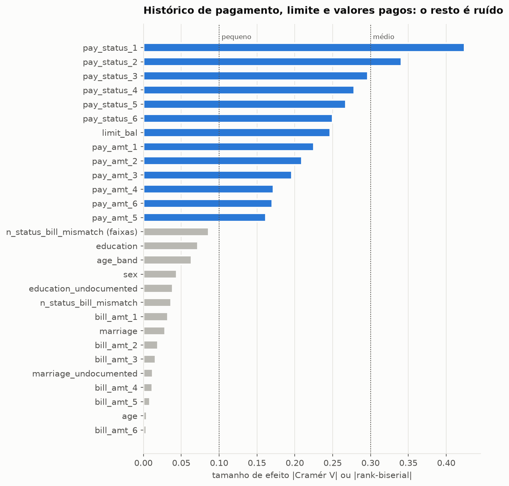

Dos **28 testes**, **13 são relevantes** e **8 são significativos, mas com efeito desprezível**: com 24 mil clientes, até diferenças mínimas viram "certeza estatística". O tamanho de efeito separa o que importa do que é ruído.

| # | Achado | Decisão |
|---|---|---|
| 1 | Default de **22,12%** (IC 95% bootstrap: 21,60%–22,66%); dizer "ninguém dá default" acerta **77,88%** | acurácia não é métrica de escolha |
| 2 | **Status de pagamento** é o sinal mais forte: V de Cramér = **0,42** em setembro, caindo até 0,25 em abril. Com 2 meses de atraso em setembro, **69%** dão default em outubro | features de atraso máximo, meses em atraso e tendência (Etapa 7) |
| 3 | **Limite de crédito**: 32% de default no quinto de menor limite e 13% no de maior (rank-biserial = -0,25) | entra no modelo e na utilização do limite |
| 4 | **Valores pagos** importam (r de -0,16 a -0,23); **valores de fatura** sozinhos não (\|r\| ≤ 0,032) | razões pagamento ÷ fatura e fatura ÷ limite (Etapa 7) |
| 5 | Sexo, escolaridade, estado civil e idade: significativos, mas **desprezíveis** (V ≤ 0,07). A idade tem um formato em U (27% aos 21–25 anos, 19% aos 30–35) que o Mann-Whitney não detecta, mas que continua fraco (V = 0,063) | não guiam a política; uso no modelo decidido com checagem de equidade |
| 6 | Status **-2 significa "quitou a fatura"**, não "sem consumo": esses clientes têm fatura positiva e pagaram 100% da anterior | `n_status_bill_mismatch` (V = 0,09) **não vira feature**; data card corrigido |

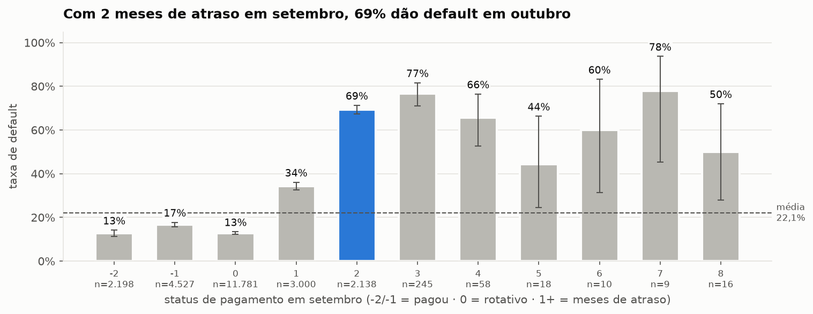

**Limite da análise:** tudo é **associação**, não causa. O limite baixo não *causa* o default; o banco deu limite baixo a quem já considerava arriscado. Isso basta para prever, mas não para recomendar "aumentar o limite reduz o risco".

### 3.2 Segmentação comportamental (Etapa 6)

Notebook: [`02_segmentacao.ipynb`](../notebooks/02_segmentacao.ipynb). Os grupos são formados **sem o alvo** e **sem perfil demográfico**: descrevem como o cliente usa e paga o cartão.

**Parte A — PCA.** Três comportamentos por mês, calculados com regras fixas (sem vazamento): utilização do limite (6 meses), fração da fatura anterior que foi paga (5 meses) e meses de atraso (6 meses), totalizando 17 colunas. Depois de padronizar (média e desvio aprendidos dentro do pipeline), o PCA resumiu as 17 colunas em **4 componentes, que explicam 82,3% da variação** (critério fixado antes: ≥ 80%; a regra de Kaiser indicaria 3).

| Componente | Variância | Leitura de negócio |
|---|---|---|
| PC1 | 50,7% | **rotativo**: usa muito do limite e paga pouco da fatura (o polo oposto quita tudo) |
| PC2 | 19,5% | **atraso** geral |
| PC3 | 6,7% | **usa muito, mas paga** (grande utilização sem rotativo) |
| PC4 | 5,4% | **tendência do atraso**: positivo = atraso recente (piorando) |

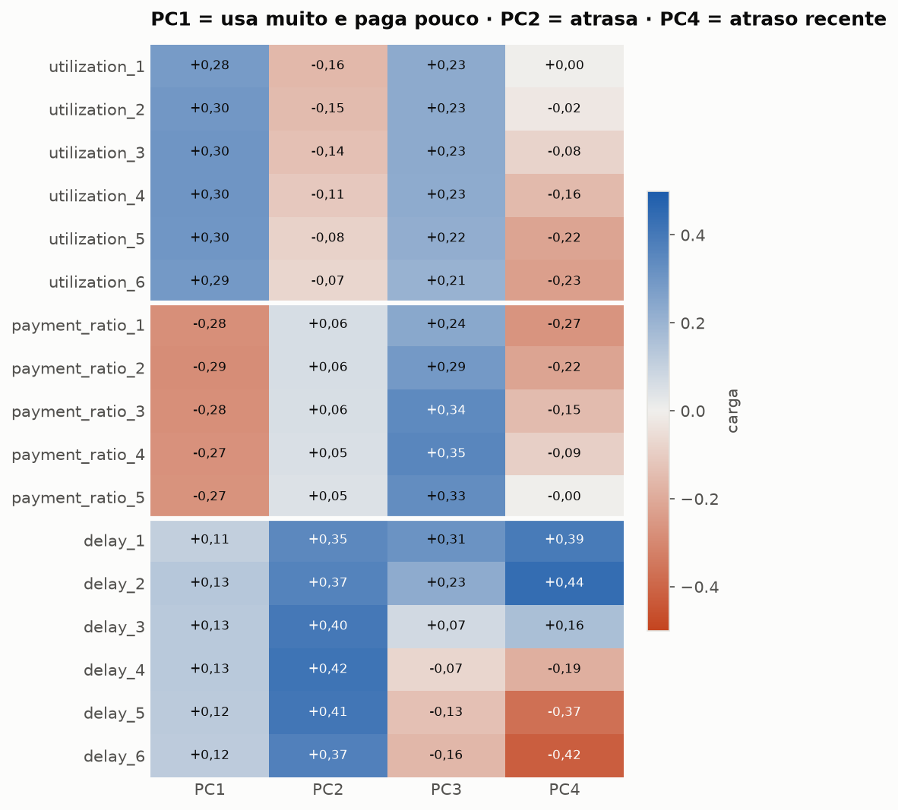

O PC4 separa o atraso recente do antigo sem nunca ter visto o alvo, o que reforça o achado da EDA de que o atraso recente é o sinal mais forte.

**Parte B — K-means.** Critérios fixados antes: k entre 3 e 8 com a melhor silhueta, desde que todo grupo tenha ≥ 5% dos clientes; estabilidade com ARI ≥ 0,8.

- **k = 3** (silhueta 0,52). O cotovelo da inércia apontaria para 4. A partir de k = 6 surge um grupo com 0,5% dos clientes (a cauda de atraso extremo), descartado pela regra de tamanho mínimo.
- **Estabilidade:** ARI ≥ 0,999 entre sementes e ≥ 0,994 em subamostras de 80%.
- Os rótulos do K-means são arbitrários; o `SegmentEncoder` renomeia os grupos por regra (o de maior atraso por último; os demais pela utilização), para que códigos e nomes sejam estáveis.

| Segmento | Clientes | Utilização (set) | Paga da fatura | Meses com atraso (de 6) | Limite mediano | Default (descritivo) |
|---|---|---|---|---|---|---|
| **Quitadores** | 10.345 (43%) | 9% | 83% (52% quitam todo mês) | 0,4 | NT$ 200 mil | 16,7% |
| **Rotativo em dia** | 11.330 (47%) | 69% (era 50% em abril) | 10% | 0,4 | NT$ 100 mil | 18,8% |
| **Atraso crônico** | 2.325 (10%) | 61% | 7% | 4,9 | NT$ 60 mil | **62,4%** |

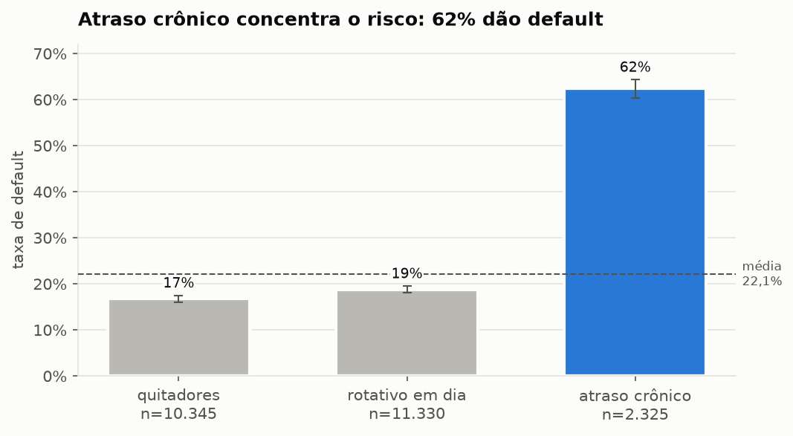

**Achado:** viver no rotativo quase não aumenta o risco **enquanto não há atraso** (18,8% × 16,7%). O atraso crônico reúne 10% dos clientes e 27% dos defaults. Para o negócio, o "rotativo em dia" é o grupo que paga juros e tem risco parecido com o dos quitadores; uma política que tratasse o rotativo como risco cortaria receita sem reduzir perda.

**Experimento: o segmento como variável do modelo.** Critério fixado: adotar só se o PR AUC subir com win rate > 60% (validação cruzada 5 × 3, mesmos folds, segmentação reajustada dentro de cada fold).

| Modelo | PR AUC sem → com segmento | Ganho médio | Win rate |
|---|---|---|---|
| Regressão logística | 0,5248 → 0,5246 | −0,0003 | 27% |
| XGBoost | 0,5550 → 0,5551 | +0,0001 (desvio 0,0035) | 47% |

**Resultado negativo:** o segmento **não entra no modelo**. Ele é um resumo grosseiro (3 categorias) das mesmas informações que o modelo já recebe. Fica com o papel de **explicar a carteira** (dashboard, política e desempenho por grupo).

### 3.3 Criação de variáveis (Etapa 7)

As colunas originais dizem "fatura de NT$ 50 mil" ou "status 2 em setembro". As **features de resumo** traduzem isso para a linguagem do risco, seguindo o que a EDA e a segmentação mostraram. Todas são **regras fixas** calculadas linha a linha (`features.py`), sem aprender nada dos dados.

| Feature | Ideia | Efeito isolado (treino) |
|---|---|---|
| `delay_months` | meses com atraso (de 6) | **r = 0,46** (o maior do projeto) |
| `delay_max` / `delay_recent` | pior atraso / atraso em setembro | r = 0,44 / 0,40 |
| `delay_trend` | atraso recente (set–jul) − antigo (jun–abr) | r = 0,18 |
| `log_limit` | limite em escala log | r = −0,25 |
| `revolving_months` | meses no rotativo (status 0) | r = **−0,22**: rotativo sem atraso é sinal **bom** |
| `pay_ratio_mean` / `pay_ratio_recent` | fração paga da fatura anterior | r = −0,18 / −0,18 |
| `util_mean` / `util_recent` | fatura ÷ limite | r = **+0,14** / +0,11 |
| `util_trend` | utilização recente − antiga | r = −0,10 (contraintuitivo, ver abaixo) |
| `util_volatility`, `paid_full_all` | variação da utilização; quitou todo mês | desprezíveis sozinhas |

- **Hipótese da EDA confirmada:** a fatura em NT$ não tinha efeito (|r| ≤ 0,032), mas a fatura **comparada ao limite** tem (r = 0,14).
- **Contraintuitivo:** quem dá default tem utilização **subindo menos** (`util_trend`). A explicação mais provável é que o limite já estava quase todo usado antes, sem espaço para subir.

**Experimento** (critério fixado: adotar se o PR AUC subir com win rate > 60%; CV 5 × 3, mesmos folds; colunas originais × originais + features de resumo):

| Modelo | PR AUC original → com features | Ganho médio | Win rate | Decisão |
|---|---|---|---|---|
| Regressão logística | 0,5069 → **0,5314** | +0,024 | **100%** | adotar |
| XGBoost | 0,5589 → **0,5626** | +0,004 | 87% | adotar |

O ganho é grande na logística e pequeno no XGBoost, como esperado: um modelo linear não consegue criar "máximo de atraso" ou "meses em atraso" sozinho, enquanto as árvores conseguem aproximar parte dessas combinações. **As features de resumo entram no conjunto oficial** (`build_features`).

*Números atualizados na Etapa 8, quando o experimento passou a usar o pré-processador oficial (XGBoost sem escala e categorias raras agrupadas); a decisão não mudou.*

### 3.4 Pré-processamento (Etapa 8)

Cada modelo "lê" os dados de um jeito, e o pré-processamento faz a tradução (`preprocessing.py`). Tudo o que ele aprende (médias, desvios, lista de categorias) fica **dentro do pipeline**, reajustado só com o treino de cada fold.

| Escolha | Motivo |
|---|---|
| Escala (padronização) **só para modelos lineares** | árvores só perguntam "é maior que X?", e a resposta não muda com a escala |
| One-hot com `handle_unknown="infrequent_if_exist"` | uma categoria nunca vista em produção não quebra o modelo |
| Categorias com menos de **50** casos no treino viram "infrequente" | `pay_status` 5 a 8 tem de 9 a 18 clientes; uma coluna própria para eles seria ruído |
| Saída em **pandas**, com nomes de coluna estáveis | permite interpretar o modelo e gerar os motivos da decisão (Etapa 15) |

**Experimento:** `pay_status` como número × como categoria na regressão logística (critério: PR AUC + win rate > 60%).

| PR AUC (número → categoria) | Ganho médio | Win rate | Decisão |
|---|---|---|---|
| 0,5314 → **0,5476** | +0,016 | **100%** | adotar nos modelos lineares |

A EDA já tinha mostrado que, na escala do `pay_status`, ir de -2 para -1 não é "um mês a mais de atraso". Como categoria, cada situação ganha um peso próprio. Nas árvores o status continua numérico.

### 3.5 Duelo de modelos (Etapa 9)

Notebook: [`03_modelagem_e_decisao.ipynb`](../notebooks/03_modelagem_e_decisao.ipynb). Quatro modelos, sem tuning, nas **mesmas 15 rodadas** de validação cruzada (5 folds × 3 repetições), cada um com o pré-processamento adequado (`models.py`). Critérios fixados antes: líder = maior PR AUC; empatado = vence o líder em ≥ 40% das rodadas.

| Modelo | PR AUC | ROC AUC | KS | Brier | Acurácia | Win rate vs XGBoost |
|---|---|---|---|---|---|---|
| **XGBoost** | **0,5626** | 0,7871 | 0,440 | 0,1333 | 82,1% | — |
| **Random Forest** | 0,5623 | **0,7879** | **0,440** | **0,1332** | 82,2% | 53% (empate) |
| Regressão logística | 0,5476 | 0,7756 | 0,427 | 0,1351 | **82,2%** | 0% |
| Árvore de Decisão | 0,5256 | 0,7723 | 0,420 | 0,1369 | 81,8% | 0% |
| Referência ("ninguém dá calote") | 0,2212 | 0,5000 | 0,000 | 0,1723 | 77,9% | 0% |

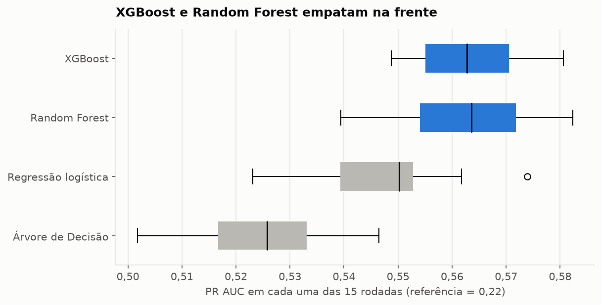

- **XGBoost e Random Forest empatam** e seguem para o tuning (Etapa 11). A hipótese registrada antes (XGBoost ≈ RF > logística > árvore) se confirma.
- **A acurácia engana:** varia menos de 0,5 p.p. entre os quatro modelos, e o modelo de **maior** acurácia (a logística) tem PR AUC **pior** que os líderes.

**Interpretação pela regressão logística.** As features de resumo são muito colineares (VIF de 10 a 19), e na logística completa até `delay_months` aparece com peso negativo, um artefato. Para interpretar, ajustei uma **logística enxuta** com 5 variáveis (todas com VIF < 3), com intervalos de confiança (`statsmodels`, pseudo-R² = 0,16):

| Variável | Razão de chances (IC 95%) | Tradução |
|---|---|---|
| +1 mês de atraso em setembro | **1,99** (1,88–2,11) | **dobra** a chance de calote |
| +1 mês com atraso no semestre | **1,33** (1,29–1,37) | +33%, além do atraso de setembro |
| Limite (+1 no log, ≈ × 2,7) | **0,78** (0,75–0,81) | dobrar o limite: ≈ −16% (associação, não causa) |
| Utilização média (+100 p.p.) | 1,15 (0,98–1,34), p = 0,09 | não significativa com o atraso no modelo |
| Paga 100% (vs. 0%) da fatura | **1,28** (1,12–1,47) | **contraintuitivo**: o efeito protetor visto na EDA era o atraso disfarçado |

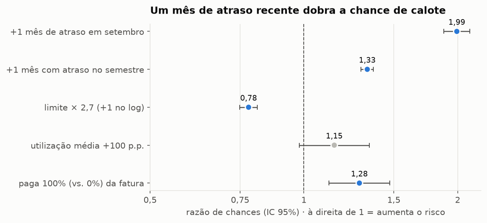

### 3.6 Balanceamento de classes (Etapa 10)

Com 22% de inadimplentes, é comum "balancear" o treino: dar peso maior aos inadimplentes (*class_weight*) ou criar inadimplentes sintéticos (*SMOTE*, aplicado só no treino de cada fold). As duas técnicas fazem o modelo enxergar um mundo com 50% de caloteiros. **Critério fixado antes:** adotar só se o PR AUC subir com win rate > 60% **e** o Brier não piorar (a probabilidade é a matéria-prima da decisão por custo).

| Modelo + técnica | Ganho em PR AUC (win rate) | Brier: sem → com | Probabilidade média prevista (real: 22,1%) |
|---|---|---|---|
| XGBoost + class_weight | +0,0005 (53%) | 0,133 → **0,174** | **40,8%** |
| XGBoost + SMOTE | −0,0052 (7%) | 0,133 → 0,135 | 25,0% |
| Random Forest + class_weight | +0,0003 (60%) | 0,133 → **0,172** | **40,7%** |
| Random Forest + SMOTE | −0,0143 (0%) | 0,133 → 0,141 | 29,1% |
| Logística + class_weight | −0,0028 (0%) | 0,135 → **0,183** | **43,3%** |
| Logística + SMOTE | −0,0034 (13%) | 0,135 → **0,183** | **43,1%** |

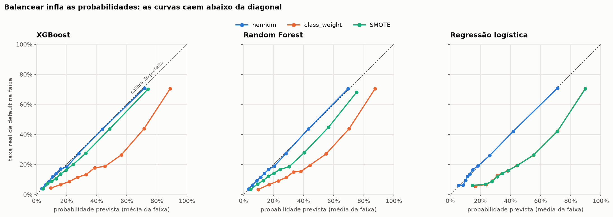

- **Nenhuma técnica passa no critério.** O PR AUC não melhora de forma consistente, e o Brier piora em **100% das rodadas** em todas as variantes. Com class_weight, o XGBoost fica com Brier **pior que a referência** que prevê 22% para todos (0,172).
- Sem balanceamento, os modelos já saem quase **calibrados**: erro médio de 0,5 a 0,8 p.p. entre a probabilidade prevista e a taxa real de cada faixa. Com class_weight, 19 a 21 p.p. Exemplo (XGBoost, 7ª faixa): 45% previsto contra 19% real.

**Decisão:** sem balanceamento (`config.BALANCING_STRATEGY = "none"`). Para achar mais inadimplentes, o caminho é **mover o limiar de decisão** com probabilidades confiáveis (Etapa 12), e não distorcer o treino. A hipótese registrada antes se confirmou.

### 3.7 Ajuste de hiperparâmetros (Etapa 11, Parte A)

Busca com **Grid** (logística: 7 valores de `C`; árvore: 24 combinações) e **Randomized** (Random Forest: 40; XGBoost: 60), otimizando PR AUC em folds sorteados com uma **semente separada** (2024). A versão escolhida é reavaliada nos folds padrão (semente 42), que a busca nunca viu. A diferença entre as duas notas mede o **otimismo da busca**. Critério: adotar se o PR AUC subir com win rate > 60% e o Brier não piorar.

| Modelo | PR AUC padrão → ajustado | Ganho | Win rate | Otimismo da busca | Decisão |
|---|---|---|---|---|---|
| XGBoost | 0,5626 → **0,5657** | +0,003 | 73% | +0,0005 | adotar |
| Random Forest | 0,5623 → **0,5642** | +0,002 | 67% | +0,0010 | adotar |
| Árvore de Decisão | 0,5256 → **0,5376** | +0,012 | 100% | +0,0034 | adotar |
| Regressão logística | 0,5476 → 0,5476 | 0 | — | −0,0007 | manter (a busca escolheu `C = 1`, o padrão) |

- O tuning ajuda pouco nos modelos fortes (≈ +0,003) e mais na árvore, o modelo mais sensível à configuração.
- O otimismo é pequeno nestes dados (≤ 0,0034). Na logística ele sai negativo: com só 7 candidatos, a "sorte" da escolha quase não atua.
- **Depois do tuning, o empate da Etapa 9 se desfaz:** a Random Forest ajustada vence o XGBoost ajustado em só 33% das rodadas de PR AUC e em 1 de 15 de ROC AUC. **O XGBoost ajustado é o líder isolado.**

Hiperparâmetros adotados: [`reports/best_params.json`](../reports/best_params.json).

### 3.8 Combinação de modelos (Etapa 11, Parte B)

Uma combinação (*ensemble*) só ajuda se os modelos errarem em clientes diferentes. A **correlação entre os erros out-of-fold** dos modelos ajustados vai de **0,976 a 0,998**; XGBoost e Random Forest (0,998) erram praticamente nos mesmos clientes.

Critério fixado: adotar só se vencer o XGBoost ajustado com win rate > 60% em PR AUC e sem piorar o Brier.

| Ensemble | Ganho em PR AUC | Win rate PR AUC | Win rate Brier | Decisão |
|---|---|---|---|---|
| Votação soft XGBoost + RF | +0,0002 | 47% | 60% | não adotar |
| Votação soft XGBoost + RF + logística | +0,0009 | 60% (não passa de 60%) | 73% | não adotar |
| Stacking XGBoost + RF + logística | +0,0009 | 73% | **13%** | **vetado pela calibração** |

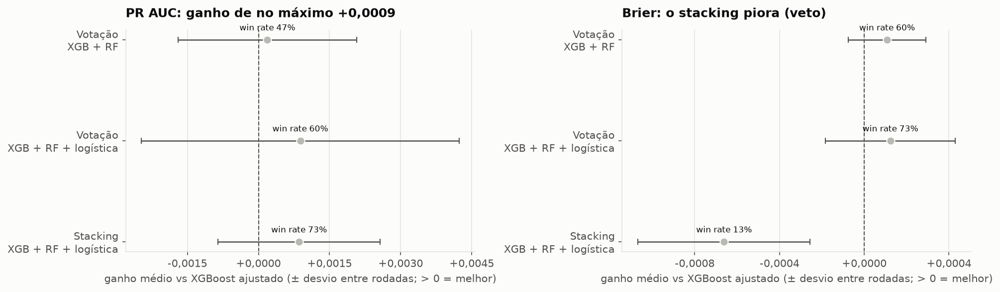

O stacking ganharia em PR AUC, mas piora o Brier em 13 de 15 rodadas. Em todos os casos, o ganho (≤ 0,0009) é menor que a variação natural entre rodadas, e três modelos custariam mais para manter e explicar.

**Decisão: o modelo final é o XGBoost ajustado, sozinho** (`config.FINAL_MODEL`).

### 3.9 Calibração (Etapa 12, Parte A)

*A partir da Etapa 13A, o modelo final não usa sexo, estado civil nem idade. Os números desta seção foram recalculados com esse modelo; as decisões não mudaram.*

A decisão por custo multiplica a probabilidade pela dívida, então a probabilidade precisa "falar a verdade". Testei duas correções no XGBoost ajustado, aprendidas em partes do treino que o modelo não viu. Critério: adotar se o Brier melhorar com win rate > 60% sem piorar o PR AUC (win rate ≥ 50%).

| Método | Brier | Win rate Brier | Win rate PR AUC | Erro médio por faixa | Decisão |
|---|---|---|---|---|---|
| Sem correção | 0,1332 | — | — | 1,2 p.p. (pior faixa: 3,5) | **mantido** |
| Sigmoid (Platt) | 0,1338 | 0% | 67% | 2,5 p.p. | não adotar |
| Isotônica | 0,1331 | 67% | **20%** | 0,2 p.p. | não adotar |

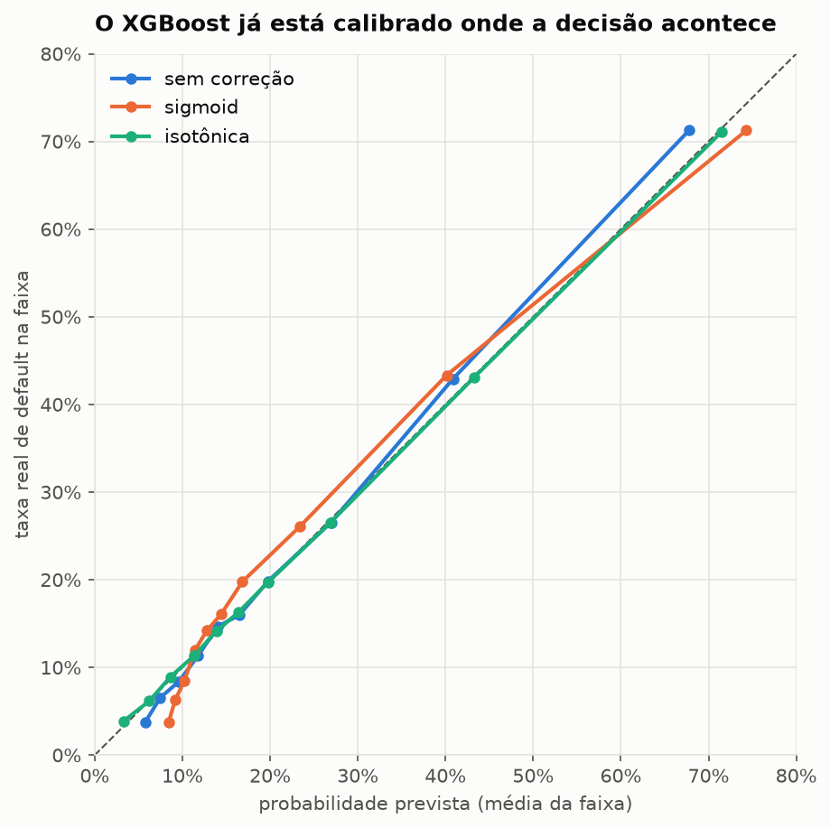

O modelo sem correção é levemente "comprimido" nas pontas (prevê 5,7% na faixa de menor risco, cuja taxa real é 3,8%; e 67,8% na de maior risco, real 71,3%), mas entre 10% e 30%, onde a decisão de agir acontece, o erro é ≤ 0,7 p.p. A isotônica corrige as pontas, mas piora o PR AUC em 80% das rodadas. **Decisão: sem correção**, pelo critério fixado. A Parte B confere, como robustez, se a isotônica mudaria o resultado financeiro.

### 3.10 Política de decisão por custo (Etapa 12, Parte B)

*A partir da Etapa 13A, o modelo final não usa sexo, estado civil nem idade. Os números desta seção foram recalculados com esse modelo; as decisões não mudaram.*

**Premissas de negócio** (`config.py`; aceitas antes de rodar e testadas na sensibilidade):

| Premissa | Valor | Justificativa |
|---|---|---|
| LGD (fração da dívida perdida no calote) | 60% | cartão de crédito não tem garantia; referências de mercado e regulatórias ficam entre 45% e 75% |
| EAD (exposição no calote) | fatura de setembro (negativa → 0) | é o que está em aberto na data da decisão |
| Eficácia da ação | 30% | uma ação preventiva reduz parte da perda, não toda |
| Custo da ação | NT$ 100 | custo operacional de um contato |
| Atrito | NT$ 300 | margem perdida ao incomodar um bom pagador |

Para cada cliente, o **valor de agir** é `LGD × EAD × eficácia − custo` se ele daria calote, e `−custo − atrito` se pagaria. Com a PD do modelo, o **valor esperado** é `PD × LGD × EAD × eficácia − custo − (1 − PD) × atrito`. Exemplo: fatura de NT$ 10.000 → agir compensa se PD > 19%; com fatura de NT$ 2.000, só acima de 62%. Tudo é calculado nas previsões out-of-fold do treino; o holdout confirma na Etapa 13.

**Sem limite de capacidade** (perda total sem ação no treino: NT$ 152,8 mi):

| Comparação | Diferença | IC 95% (bootstrap) |
|---|---|---|
| Regra por cliente (valor esperado > 0) − não agir | **+NT$ 40,4 mi** | 38,3 a 42,7 mi |
| Regra por cliente − melhor regra fixa ("≥ 1 mês com atraso") | **+NT$ 13,4 mi** | 11,9 a 14,8 mi |

O critério de sucesso (Seção 1.5) está cumprido no treino. **Porém**, com estas premissas, acionar um caloteiro típico evita ≈ NT$ 3.600 e acionar um bom pagador custa NT$ 400, então a política aciona **59% da carteira** e o "melhor limiar único" degenera para 0,01. Como nenhuma operação aciona 60% dos clientes por mês, a política foi revista **depois de ver este resultado** (decisão registrada): premissas mantidas, com uma **restrição de capacidade de 10%** da carteira por mês. A calibração isotônica mudaria o valor em só 0,01%, o que confirma a escolha da Seção 3.9.

**Com capacidade de 10%: quem acionar?** Critério: o valor esperado precisa vencer a regra de atraso com IC 95% acima de zero.

| Política (2.400 clientes) | Calotes alcançados | Valor |
|---|---|---|
| **Maior valor esperado** (PD × exposição) | 1.142 (21,5%) | **NT$ 26,7 mi** |
| Maior PD | 1.711 (32,2%) | NT$ 17,9 mi |
| Regra de atraso (sem modelo; desempata pela maior fatura) | 1.701 (32,0%) | NT$ 19,0 mi |

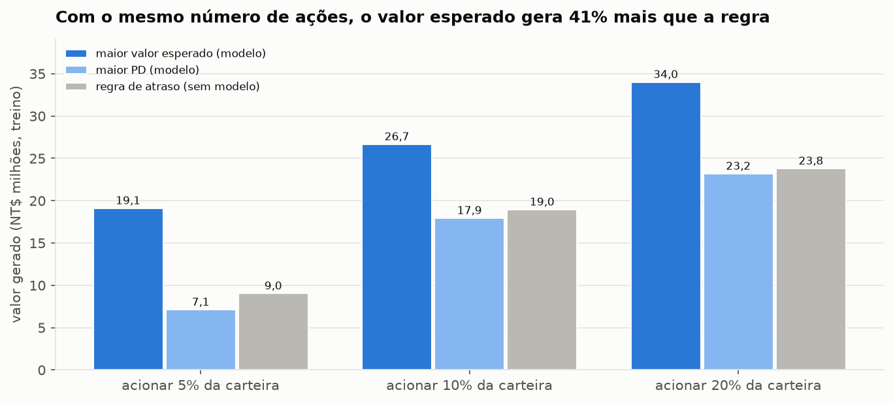

- **Valor esperado − regra de atraso: +NT$ 7,7 mi** (IC 6,3 a 9,2 mi); +10,1 mi com capacidade de 5% e +10,2 mi com 20%.
- **Contraintuitivo:** ordenar só pela PD **perde** da regra de atraso (−NT$ 1,0 mi; IC −1,6 a −0,5 mi). A regra desempata pela maior fatura, ou seja, já considera o valor em jogo. **Um bom modelo de risco sozinho não basta; o valor vem de combinar a probabilidade com a exposição.**
- **Sensibilidade:** o modelo vence a regra em todos os 12 cenários (+NT$ 3,8 mi a +15,6 mi). A eficácia da ação é a premissa que mais pesa. A política evita 17,5% da perda total da carteira.

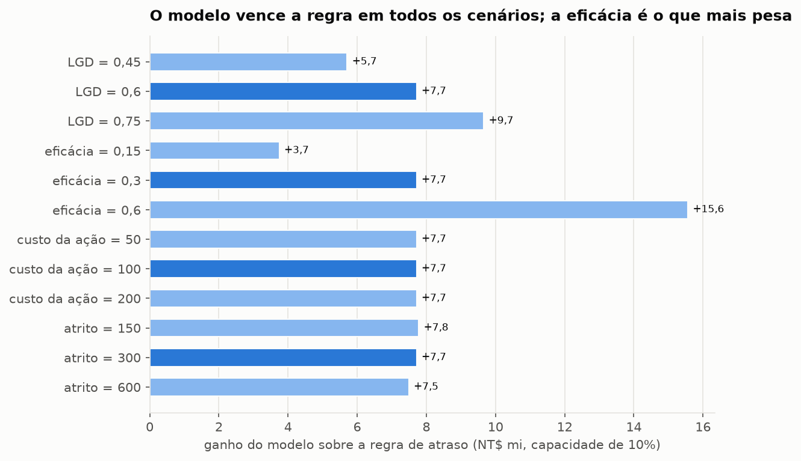

**Política oficial:** acionar, por mês, os **10% de clientes com maior valor esperado de ação** (`config.CAPACITY`).

### 3.11 Atributos sensíveis (Etapa 13, Parte A)

Usar sexo ou estado civil para decidir sobre crédito é eticamente questionável e, em vários países, restrito por lei (no Brasil, a LGPD proíbe o tratamento de dados pessoais para fins discriminatórios). A decisão foi tomada **no treino, antes do holdout**, para não escolher o modelo olhando a prova. Critério de **não inferioridade**: remover se o PR AUC cair menos de 0,005 e o valor da política menos de 2%, preferindo a variante mais restritiva.

| Variante | PR AUC | Valor da política (10%) |
|---|---|---|
| Com sexo, estado civil e idade | 0,5657 | NT$ 26,64 mi |
| Sem sexo e estado civil | 0,5658 | NT$ 26,71 mi |
| **Sem sexo, estado civil e idade** | **0,5657** | **NT$ 26,67 mi** |

**Decisão:** o modelo final **não usa sexo, estado civil nem idade** (`config.MODEL_EXCLUDE`); a escolha ética não tem custo. Esses dados ficam só para **auditar** a equidade no holdout. O modelo oficial é `models.final_pipeline()`, usado em toda a decisão; os números das Seções 3.9 e 3.10 já foram recalculados com ele.

> TODO (Etapas 13B–17).

## 4. Conclusões

> TODO (Etapa 20).
